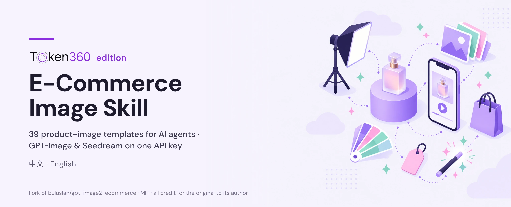
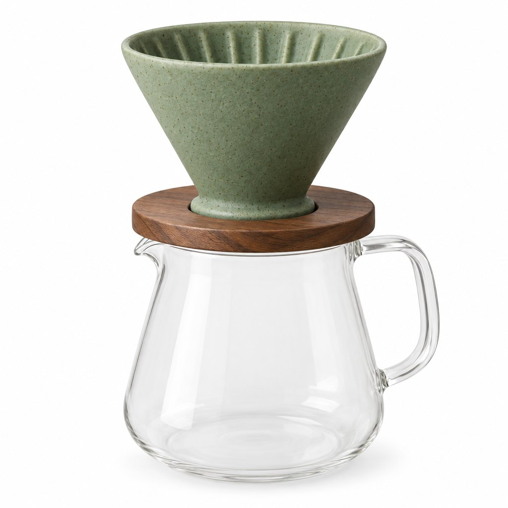
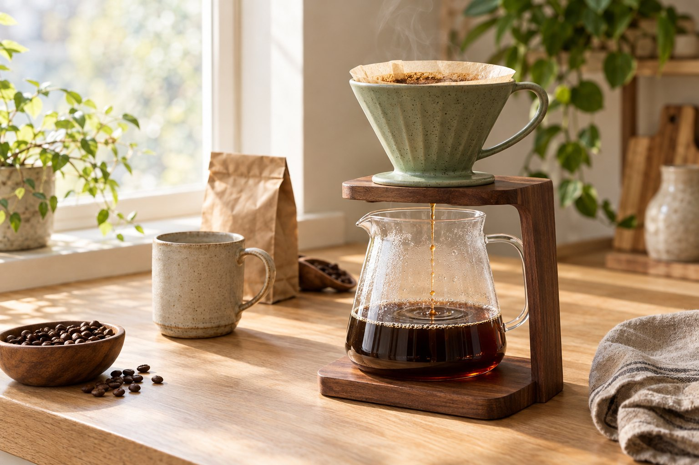
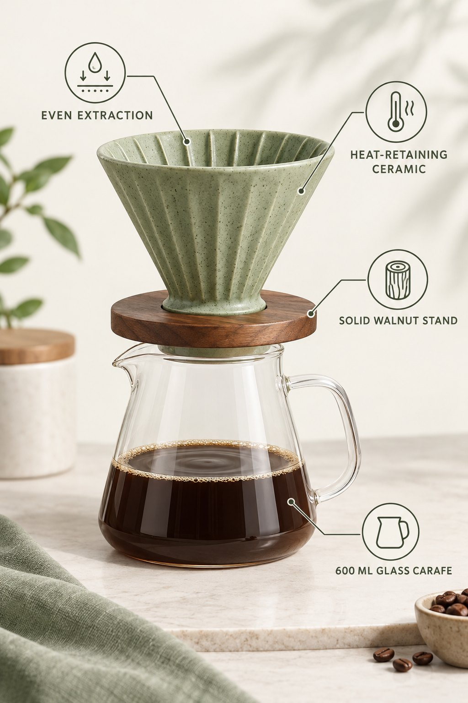
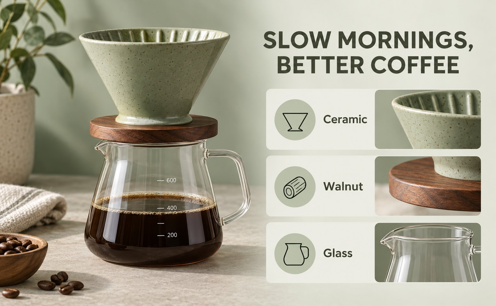
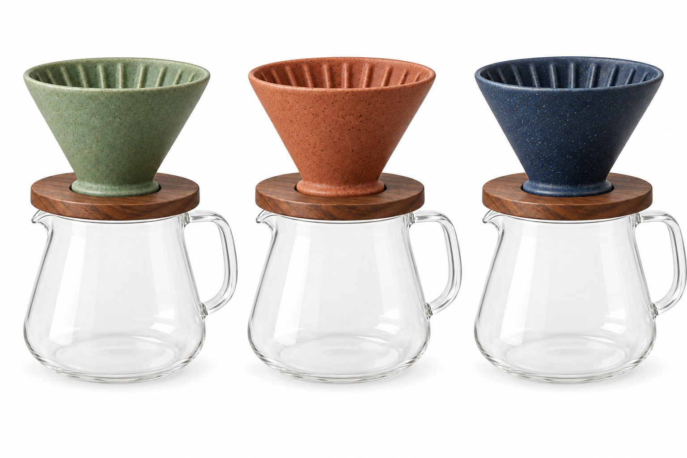
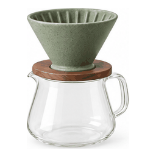

<div align="center">



# 🎨 E-Commerce Image Generator · Token360 edition

**Cross-border e-commerce visual assets powered by GPT-Image-2/2.5. Provider-agnostic: 39 scenario templates turn a product photo into listing-ready images in minutes.**

[中文](README.md) · [English](README.en.md)

[](LICENSE)
[](https://docs.anthropic.com/en/docs/claude-code)
[]()
[]()
[]()
[](https://www.token360.ai/en-US/explore?utm_source=github&utm_medium=fork&utm_campaign=ecom-image-skill)

**39 e-commerce templates · GPT-Image-2.5 two-model routing · campaign-set consistency · platform pre-checks · edit matrix · product motion GIFs · two-layer anti-"AI look" filter**

</div>

> [!NOTE]
> **Forked from [buluslan/gpt-image2-ecommerce](https://github.com/buluslan/gpt-image2-ecommerce) by [buluslan](https://github.com/buluslan) (Buluu@新西楼.AI), licensed MIT. All credit for the original work goes to them.**
>
> The 39 scenario templates, the prompting method, the scripts and the docs are the work of the original author and the [upstream contributors](https://github.com/buluslan/gpt-image2-ecommerce/graphs/contributors). This Token360 edition only adds a Token360 quick start, a few generic compatibility fixes in `scripts/imagegen.sh`, a new header image and a gallery generated with Token360 models. It is not affiliated with or endorsed by the original author. The original [LICENSE](LICENSE) and copyright notice are unchanged; every change is listed in [NOTICE](NOTICE). Please ⭐ the [original project](https://github.com/buluslan/gpt-image2-ecommerce), and send improvements that aren't Token360-specific upstream.
>
> **Original author's credit and contact:** Created By Buluu@新西楼.AI · For the latest AI industry news, AI + e-commerce/advertising practice, and thoughts on how people and AI work together, follow the WeChat Official Account 【新西楼.AI】:
>
> 

## ⚡ Token360 quick start

One key for GPT-Image-2.5 Flare / Sunburst, GPT-Image-2, Seedream and more. No code changes, just environment variables:

1. Create an account and an API key: [sign up at token360.ai](https://www.token360.ai/en-US/sign-up?utm_source=github&utm_medium=fork&utm_campaign=ecom-image-skill)
2. Set the base URL and model, then generate your first image (needs bash, jq, curl):

```bash
export TOKEN360_API_KEY="sk-..."                    # your Token360 key (never commit it)
export IMAGE_API_BASE="https://api.token360.ai/v1"
export IMAGE_API_KEY="$TOKEN360_API_KEY"
export IMAGE_MODEL="gpt-image-2.5-flare"            # gpt-image-2.5-sunburst for precise edits
export IMAGE_REF_FIELD="images"                     # Token360's reference-image field (used with --image)

bash scripts/imagegen.sh --size 1024x1024 --quality medium \
  --prompt '{"subject":"matte sage-green ceramic pour-over coffee dripper on a walnut stand","scene_type":"product photography","use_case":"white-background marketplace hero"}' \
  | jq -r '.data.images[0]'
# → file:///tmp/imagegen.XXXXXX.png   (about 15 s and about $0.02 in our test)
```

**Low-cost bulk route** (SKU variants, social posts): `IMAGE_MODEL="seedream-4.5"` ($0.0518/image) or `IMAGE_MODEL="dola-seedream-5.0-lite"` ($0.0453/image), plus `IMAGE_EXTRA_BODY='{"watermark":false}'` to turn off Seedream's default watermark. Live prices and the full model list: [Token360 models](https://www.token360.ai/en-US/explore?utm_source=github&utm_medium=fork&utm_campaign=ecom-image-skill). Every other provider (official OpenAI, OpenAI-compatible relays, manual mode) still works as before; see Quick start below.

## 🖼️ Made with Token360

Generated through Token360 with this skill's own scenario templates and `scripts/imagegen.sh` (a fictional, unbranded product; prompts, models and cost per image are in [examples/token360-gallery](examples/token360-gallery/README.md)):

| White-background hero · hero-image | Lifestyle · lifestyle-scene | Infographic · infographic | A+ module · a-plus-modules |
|---|---|---|---|
|  |  |  |  |
| `gpt-image-2.5-flare` | `gpt-image-2.5-flare` | `gpt-image-2.5-sunburst` | `gpt-image-2.5-sunburst` |
| **SKU recolor · edit-recolor** | **Product motion · motion-gif** | **Flat lay · flat-lay** | **Gift set · gift-set** |
|  |  |  |  |
| `gpt-image-2.5-sunburst` + reference image | `gpt-image-2.5-sunburst` 16-frame grid → GIF | `dola-seedream-5.0-lite` | `seedream-4.5` |

---

## About

E-Commerce Image Generator is an open-source e-commerce image skill built by **buluslan (WeChat Official Account: 新西楼.AI)**.

You give it product assets, a target platform and what you need. It matches one of 39 scenario templates, assembles a reusable generation or edit prompt, and generates images through the endpoint and model you configured. A script then checks white background, foreground ratio and OCR status, flags platform risks that need a human look, and hands you the images, the prompt pack and the check results.

> [!TIP]
> **For more hands-on AI content for cross-border e-commerce, follow the WeChat Official Account「新西楼.AI」**

As an **agent-native** tool it works with Claude Code, Codex, Cursor, OpenClaw and other AI coding agents, and runs on bash + jq + curl. **Provider-agnostic:** you choose the image endpoint (official OpenAI, any OpenAI-compatible relay, a cloud gateway). It even works with no key at all: export a prompt pack and paste it into ChatGPT.

---

## ✨ What it does

### 39 e-commerce scenario templates

Covers the full e-commerce visual pipeline plus editing:

| Category | Scenarios |
|------|------|
| Product display | white-background hero / lifestyle / flat-lay / macro detail / multi-angle grid / ghost mannequin / creative concept / luxury atmospherics |
| Marketing | poster banner / social media / UGC buyer-show / model showcase / livestream room / seasonal campaign / sports ad / magazine editorial / gift set |
| Information & specs | A+ module (970x600) / feature infographic / size spec / comparison (vs competitor) / brand story / packaging / unboxing flow |
| **Edit matrix** | background swap / recolor (SKU variants) / seasonal swap / localization / masked local edit, with explicit preserve lists and minimal unrelated change |
| **Motion & bulk** | product motion GIF (16-frame grid → GIF/WebP) / bulk-product-swap / layout-preserving bulk-translate / transparent cutout |

(The full trigger-phrase routing table is in SKILL.md Step 2.)

### GPT-Image-2.5 two-model routing

OpenAI ships two GPT-Image-2.5 models: **Flare** is the default for most tasks (fast, high-quality everyday generation); **Sunburst** is for professional workflows that need tighter edit control and finished-asset precision. The skill suggests a model by "fast generation vs. precise edit". With third-party compatible endpoints, confirm the endpoint actually exposes the official model IDs. See `references/model-routing.md`.

### Platform pre-checks

These are technical pre-checks and risk hints, not platform review or legal advice:

- **Platform hard constraints:** main-image specs for Amazon / TikTok Shop / Shopify / AliExpress + Temu (type-A main image: pure white RGB(255,255,255) / ≥85% fill / no text or logo / 1:1 / ≥1000px)
- **AIGC regulation tracking:** New York SB 8420-A / FTC / California SB 942 + EU AI Act Art. 50, with fines and seller requirements
- **`compliance_check.py` automatic checks:** background whiteness / foreground ratio / OCR text. Missing OCR is reported as skipped, never as passed
- **4 image types:** A real photo, no people / B routine retouch / C realistic AI person (disclosure required) / D replicating a real person (blocked)
- **Three red lines:** don't strip C2PA / SynthID, don't help evade AI labeling, don't fake real photos

### Campaign Style Lock (set consistency)

**Templates are only the starting point; consistency is what makes it look finished.** A 10-field lock plus a 6-layer funnel reduces visual drift across a whole listing set, from hero to packaging:

- **10-field lock protocol** + prepend mechanism: no visual drift across the set
- **6-layer funnel, 9-slot set planning:** a precise mode (slot by slot) and a fast lane (one prompt for the whole set)
- **Region adaptation:** US / EU / SEA / CN / ME aesthetic lookup

### Two-layer anti-"AI look" filter

A prompt text layer (slop-word filter + five-element assembly rule) plus a visual layer (8 kinds of AI tells). Core craft principles are in `references/craft.md`.

---

## 🚀 Quick start

### Image channel (pick one; provider-agnostic)

**api mode (recommended):** any OpenAI-compatible endpoint, three environment variables:

```bash
export IMAGE_API_BASE="https://api.openai.com"   # or your relay / gateway base
export IMAGE_API_KEY="sk-xxx"                     # legacy OPENAI_API_KEY also works
export IMAGE_MODEL="gpt-image-2.5-flare"          # gpt-image-2.5-sunburst for precise edits
```

Official OpenAI, OpenAI-compatible relays and cloud gateways (Vercel AI Gateway / Cloudflare Workers AI, etc.) all work. Reference images go in `image_urls` automatically, falling back to the official `/v1/images/edits` when an endpoint rejects that. (Token360 edition: `IMAGE_API_BASE` works with or without a trailing `/v1`; rename the reference field with `IMAGE_REF_FIELD` and pass extra request fields with `IMAGE_EXTRA_BODY`; see the Token360 quick start above.)

**manual mode (no channel):** no API at all; export a prompt pack and paste it into ChatGPT or curl it yourself.

**cli mode** (codex exec) is DEPRECATED legacy.

### Install

```bash
git clone https://github.com/buluslan/gpt-image2-ecommerce.git ~/.claude/skills/ecom-image2
cd ~/.claude/skills/ecom-image2
```

(For this Token360 edition, clone the Token360 fork's URL instead once it is published.)

Requirements: bash 3.2+, jq, curl, base64, awk (Mac/Linux). The pre-check also needs Python 3.9+ and Pillow; OCR additionally needs pytesseract and tesseract, and degrades explicitly when missing.

> In api mode your product and reference images are uploaded to the endpoint you configure. Only use assets you have the right to upload, and check the endpoint's data-retention and privacy terms first.

### Usage 1: inside an agent (recommended)

Put it on your Claude Code skills path (Codex / Cursor users: feed SKILL.md to the agent as instructions) and describe what you need:

```
Make a sports ad image for an e-bike: dark background, sense of speed
Make a consistent 5-image Amazon listing set (hero + lifestyle + features + comparison + packaging)
Make an auto-looping motion image of this product for the main image
Swap my product into this best-selling image set, keep the layout
```

The agent matches templates, assembles the prompt, suggests a model for your endpoint, generates through your channel and runs the pre-checks.

### Usage 2: command line

```bash
# api mode
bash scripts/imagegen.sh \
  --prompt-file <(echo '{"subject":"frosted glass serum bottle","scene_type":"product photography"}') \
  --size 1024x1024 --quality high --mode api

# manual mode: export a prompt pack (no channel)
bash scripts/imagegen.sh --prompt-file prompt.json --mode manual --output ./my-prompt-pack

# pre-check (after generation)
python3 scripts/compliance_check.py generated.png --platform amazon --strict | jq .
```

stdout is a single JSON envelope (`jq .data.images`; `data.cost` appears when the channel reports cost).

---

## 🧠 Foundations

- **Five-element assembly rule:** every production prompt = subject + material + light + lens/ratio + finish, as a short production brief ("material beats adjectives")
- **Edit fidelity:** "change only X" + an explicit preserve list. The model doesn't know your business red lines; whatever you leave out is what gets changed
- **Three text-rendering tricks:** quotes + ALL CAPS / letter-by-letter fallback / "no extra words" (as in the official prompting guide)
- Details in `references/craft.md` (the "why" layer, not a pile of rules)

---

## 🏠 Community (original author's)

<div align="center">

🎯 **More hands-on AI tutorials and member perks in the author's 「MBG 跨境AI实战圈」 community (in Chinese), with 50+ cross-border sellers and AI experts.**

Community intro: [my.feishu.cn/wiki/WNi0wh3mIiOLhzkCLFPcwUr9nrg](https://my.feishu.cn/wiki/WNi0wh3mIiOLhzkCLFPcwUr9nrg)

</div>

---

## 📁 Structure

```
gpt-image2-ecommerce/
├── SKILL.md                        # skill entry (7-step workflow + scenario routing table)
├── README.md / README.en.md / CHANGELOG.md / LICENSE / NOTICE
├── scripts/
│   ├── imagegen.sh                 # provider-agnostic generation entry (api/manual/cli)
│   └── compliance_check.py         # main-image pre-check
├── references/
│   ├── scenarios/                  # 39 scenario templates (JSON)
│   ├── model-routing.md            # 2.5 two-model selection and cost
│   ├── motion-gif.md               # product motion GIF method
│   ├── craft.md                    # craft principles (five elements / text / edit fidelity)
│   ├── campaign-style-lock.md      # set consistency protocol
│   ├── funnel-set.md               # set planning funnel
│   ├── style-blacklist.md          # category × style conflicts + slop words
│   └── platform-constraints.md     # platform hard constraints
├── assets/                         # header (Token360 edition) + default style-lock baseline
├── examples/token360-gallery/      # Token360 edition: sample outputs + prompts
└── evals/                          # 11 test cases
```

## 🙏 Credits

- The product motion GIF method is adapted from the open-source project [liangdabiao/product-motion-gif](https://github.com/liangdabiao/product-motion-gif)
- The transparent-cutout recipe comes from the [official OpenAI prompting guide](https://developers.openai.com/api/docs/guides/image-prompting)

## 🔀 Differences from upstream (Token360 edition)

- Added the Token360 quick start, the gallery, `.env.example` and this English README; replaced the header (the original `assets/banner.png` was removed)
- Generic fixes in `scripts/imagegen.sh` (no effect on other providers): `IMAGE_API_BASE` may end in `/v1`; `n` is only sent when >1 (some models reject it); new `IMAGE_REF_FIELD` and `IMAGE_EXTRA_BODY`; fixed GNU `base64` line wrapping that made reference-image requests invalid JSON on Linux
- Full list in [NOTICE](NOTICE)

---

<div align="center">

**If this tool helps you, please ⭐ the [original project](https://github.com/buluslan/gpt-image2-ecommerce). For more AI × cross-border e-commerce practice, follow the WeChat Official Account「新西楼.AI」.**

</div>

---

## 📜 License

MIT License, see [LICENSE](LICENSE) (original copyright notice retained; Token360 changes are described in [NOTICE](NOTICE)).
